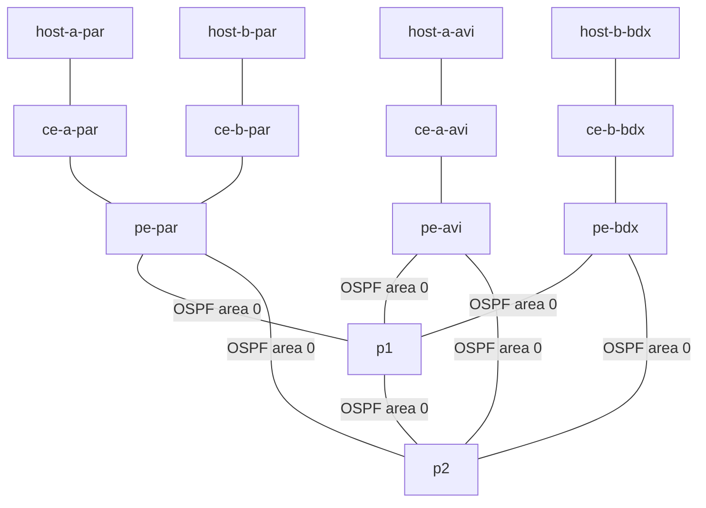

# PoC MPLS L3VPN — documentation du projet depuis son démarrage

**État de référence : dernière campagne réseau validée.**

**Dépôt : [Romain397/Reseau-NetOps](https://github.com/Romain397/Reseau-NetOps).**

Ce document rassemble l'analyse du besoin, la conception, la préparation des
fichiers, les contrôles des VM, le déploiement, les configurations, les tests,
l'accès depuis VS Code et le versionnement Git. Il s'appuie sur l'historique
du dépôt, les configurations exportées et les bilans de tests conservés.

Le résultat acquis est une **base réseau IP et OSPF fonctionnelle :
13 conteneurs, 15 liens et 91 contrôles réussis**. Le service MPLS L3VPN
complet constitue la suite du projet : il n'est pas encore opérationnel.

## 1. Besoin initial et objectifs

Le projet vise à simuler un opérateur qui fournit deux intranets distincts :

| Filiale | Sites à relier | VRF cliente prévue |
|---|---|---|
| A | Paris et Avignon | TENANT_1 |
| B | Paris et Bordeaux | TENANT_2 |

À terme, les deux sites d'une même filiale devront communiquer et les
filiales devront rester isolées. Le réseau opérateur doit transporter leurs
routes au moyen d'un service MPLS L3VPN. La conception prévoit OSPF et LDP
dans le cœur, MP-BGP VPNv4 entre les PE et un Route Reflector sur P1,
puis eBGP entre chaque PE et son CE.

Les exigences reprises dans la [feuille de route](feuille-de-route.md)
comprennent aussi le versionnement, un déploiement reproductible, la mesure
d'un objectif inférieur à 20 minutes par intranet, l'automatisation Ansible
et une future chaîne de supervision.

L'objectif de la première réalisation a été volontairement limité au socle :
organiser le projet, déployer les équipements, adresser les interfaces,
configurer les loopbacks et rendre le backbone joignable par OSPF avant de
mettre en place les fonctions clientes et MPLS.

## 2. Suivi du projet

| Étape | Travail réalisé | Trace |
|---|---|---|
| 1 | Initialisation du dépôt et licence MIT | `a80f612` |
| 2 | Analyse et préparation : feuille de route, inventaire, adressage, squelette Jinja2, configuration Ansible, règles Git | `b36a908` |
| 3 | Adaptation de la préparation aux VM toolsG2 et labG2 et à leurs adresses réelles | `2730803` |
| 4 | Contrôles SSH des ressources de LAB, de Docker, des images, des réseaux et des droits ; inspection de TOOLS | Relevés d'environnement et journal de déploiement |
| 5 | Déploiement des 13 conteneurs et création des 15 liens avec Containerlab 0.79.0 | Journal de déploiement sur LAB |
| 6 | Validation de la base : 61/61 contrôles réussis | `base-summary.json` |
| 7 | Activation OSPF sur les cinq P/PE et sauvegarde des configurations | Fragments CLI et snapshots EOS |
| 8 | Validation OSPF : 91/91 contrôles réussis | `ospf-summary.json` |
| 9 | Versionnement du déploiement, des scripts et des preuves | `98be706` |
| 10 | Installation de Remote SSH, création d'une connexion par clé à LAB, installation distante de Containerlab et vérification des 13 nœuds dans l'interface | `docs/vscode-containerlab.md` |
| 11 | Mise à jour Containerlab 0.79.0 → 0.82.0 observée dans le terminal VS Code | Version relevée sur LAB |
| 12 | Nouvelle validation après configuration de VS Code et mise à jour : 91/91 contrôles réussis | `ospf-after-vscode-summary.json` |
| 13 | Documentation de l'accès distant et vérification détaillée des versions dans pipx | `ef9e680` |
| 14 | Ajout du guide pratique, push GitHub jusqu'à `4b33035`, puis mise à jour des copies LAB et TOOLS | Branche `main` synchronisée à la clôture de cette étape |

Le temps de déploiement mesuré,
environ **4 minutes 12 secondes**, concerne le laboratoire complet. Il ne
valide pas encore le critère de durée d'un service L3VPN par intranet.

## 3. Environnement fourni et répartition des rôles

Les VM, Docker, les images et l'environnement Nautobot existaient avant la
réalisation décrite ici. Leur présence a été contrôlée ; leur installation
initiale ne doit pas être attribuée aux scripts de ce dépôt.

### 3.1 Les deux VM

| Élément | LAB / labG2 | TOOLS / toolsG2 |
|---|---|---|
| Adresse ens18 | 10.108.2.65/24 | 10.108.2.29/24 |
| Compte d'administration | NetOps | NetOps |
| CPU disponibles dans la VM | 8 | 4 |
| RAM totale | 23 Gio | 11 Gio |
| RAM disponible avant déploiement | Environ 22 Gio | Environ 11 Gio |
| RAM disponible après déploiement de LAB | Environ 11 Gio | Environ 11 Gio au relevé |
| Disque disponible avant réalisation | Environ 67 Go | Environ 66 Go |
| Disque disponible au contrôle suivant | Environ 66 Go | Environ 66 Go |
| Rôle retenu | Containerlab, 9 cEOS et 4 hosts, configuration et tests, premier contrôleur Ansible | Copie Git, documentation, Nautobot existant et futurs outils complémentaires |

Les ressources sont des relevés ponctuels. Les adresses des VM sont
attribuées par DHCP ; une réservation ou une actualisation des paramètres
de connexion sera nécessaire si elles changent.

Les contrôles ont confirmé l'appartenance de NetOps au groupe `docker` sur
les deux VM et le fonctionnement de `sudo -n true`. LAB dispose aussi du
groupe `clab_admins`. Les pings LAB → TOOLS et TOOLS → LAB ont chacun reçu
trois réponses sur trois, sans perte, lors du contrôle.

### 3.2 Logiciels et environnements Python

| Logiciel | LAB | TOOLS |
|---|---|---|
| Docker client et serveur | 29.7.2 | 29.7.2 |
| Containerlab | 0.79.0 au déploiement ; 0.82.0 au dernier contrôle | Non disponible dans le PATH contrôlé |
| Git | Exécutable disponible | 2.43.0 |
| Python système | 3.12.3 | 3.12.3 |
| Ansible | ansible-core 2.21.3 via pipx | Non disponible dans le PATH contrôlé |
| Jinja2 du Python système | 3.1.2 | Non relevé |
| PyYAML du Python système | 6.0.1 | Non relevé |
| Jinja2 de l'environnement Ansible | 3.1.6 | Sans objet pour cette phase |
| PyYAML de l'environnement Ansible | 6.0.3 | Sans objet pour cette phase |

Ansible est installé sous
`/home/NetOps/.local/share/pipx/venvs/ansible` et son exécutable est exposé
par `/home/NetOps/.local/bin/ansible`. Une commande SSH non interactive peut
ne pas inclure `~/.local/bin` dans son PATH. L'utilisation de ce chemin
explicite a confirmé les versions annoncées ; Ansible n'était pas absent.
Les scripts du déploiement ont fonctionné avec le Python système de LAB.

### 3.3 Images et conteneurs préexistants

Les cinq images suivantes ont été confirmées sur LAB :

| Image | Usage dans cette phase |
|---|---|
| `ceos:4.36.1F` | Neuf routeurs CE, PE et P |
| `ghcr.io/srl-labs/network-multitool:latest` | Quatre hosts Linux |
| `ghcr.io/siemens/ghostwire:latest` | Image disponible pour l'outillage existant |
| `ghcr.io/siemens/packetflix:latest` | Image disponible, non déployée par le PoC |
| `ghcr.io/srl-labs/wireshark-vnc-docker:latest` | Image disponible, non déployée par le PoC |

Les images du PoC ont été utilisées sans téléchargement sur LAB. Leurs
identifiants précis et le digest du host sont consignés dans le
[journal de déploiement](journal-2026-11-06.md). Le tag `latest` du host étant
mutable, ces identifiants permettent de retrouver l'image effectivement utilisée.

EdgeShark et Ghostwire sont restés en fonctionnement sur LAB. Le PoC ajoute
13 conteneurs aux deux conteneurs existants : 15 conteneurs actifs étaient
donc visibles sur LAB au contrôle.

Sur TOOLS, les conteneurs Nautobot, PostgreSQL, Redis, Celery Worker et
Celery Beat étaient **présents mais arrêtés**. Aucun de ces cinq conteneurs
n'a été démarré, supprimé ou reconfiguré pendant cette réalisation.

## 4. Architecture retenue

Le schéma utilise quatre sites clients et trois PE. Les deux sites de Paris
partagent **PE-PAR**. Chaque PE est relié à P1 et à P2 ; un lien relie aussi
P1 à P2. L'ensemble compte quatre liens host-CE, quatre liens CE-PE et
sept liens de backbone, soit **15 liens de données**.



Ce schéma représente le câblage et OSPF réalisés. Les CE et hosts ne
participent pas à l'OSPF du backbone. Le rôle Route Reflector prévu pour P1
ne sera actif qu'après configuration de MP-BGP ; il ne l'est pas à ce stade.

### 4.1 Management et loopbacks des 13 équipements

| Équipement | Type | IPv4 de management /24 | Loopback0 /32 |
|---|---|---|---|
| p1 | P | 172.31.255.11 | 10.255.0.1 |
| p2 | P | 172.31.255.12 | 10.255.0.2 |
| pe-par | PE | 172.31.255.13 | 10.255.0.11 |
| pe-avi | PE | 172.31.255.14 | 10.255.0.12 |
| pe-bdx | PE | 172.31.255.15 | 10.255.0.13 |
| ce-a-par | CE | 172.31.255.17 | 10.255.0.101 |
| ce-a-avi | CE | 172.31.255.18 | 10.255.0.102 |
| ce-b-par | CE | 172.31.255.19 | 10.255.0.103 |
| ce-b-bdx | CE | 172.31.255.20 | 10.255.0.104 |
| host-a-par | Host Linux | 172.31.255.101 | Sans objet |
| host-a-avi | Host Linux | 172.31.255.102 | Sans objet |
| host-b-par | Host Linux | 172.31.255.103 | Sans objet |
| host-b-bdx | Host Linux | 172.31.255.104 | Sans objet |

Le réseau Docker `netops-mgmt` utilise `172.31.255.0/24`, avec la passerelle
de bridge `172.31.255.1`. Les réseaux existants `172.17.0.0/16` et
`172.18.0.0/16` ne le chevauchent pas. Ces bridges sont locaux à chaque VM.

Sur les cEOS, Management0 est placé dans la **VRF MGMT**. Elle sépare
l'administration du réseau de données ; elle ne constitue pas une VRF
cliente MPLS L3VPN. Les tests entre loopbacks utilisent explicitement
Loopback0 comme source, sans détour par le management.

### 4.2 LAN des quatre sites

| Site | LAN | Passerelle CE | Host |
|---|---|---|---|
| A Paris | 10.10.10.0/24 | 10.10.10.1 | 10.10.10.10 |
| A Avignon | 10.10.20.0/24 | 10.10.20.1 | 10.10.20.10 |
| B Paris | 10.20.10.0/24 | 10.20.10.1 | 10.20.10.10 |
| B Bordeaux | 10.20.20.0/24 | 10.20.20.1 | 10.20.20.10 |

Les hosts disposent d'une interface eth1 pour leur LAN et de routes vers
les trois autres LAN via leur CE. Leur route de management demeure sur
eth0. La présence de ces routes ne suffit pas à assurer les échanges
intersites : le service L3VPN reste à configurer.

### 4.3 Les 15 liens avec leurs adresses

`ethN` dans Containerlab correspond à `EthernetN` dans EOS.
Le management utilise eth0 / Management0 et n'est pas compté parmi ces liens.

| N° | Extrémité A | IPv4 A | Extrémité B | IPv4 B |
|---:|---|---|---|---|
| 1 | pe-par:Ethernet3 | 172.16.0.1/30 | ce-a-par:Ethernet1 | 172.16.0.2/30 |
| 2 | ce-a-par:Ethernet2 | 10.10.10.1/24 | host-a-par:eth1 | 10.10.10.10/24 |
| 3 | pe-avi:Ethernet3 | 172.16.0.5/30 | ce-a-avi:Ethernet1 | 172.16.0.6/30 |
| 4 | ce-a-avi:Ethernet2 | 10.10.20.1/24 | host-a-avi:eth1 | 10.10.20.10/24 |
| 5 | pe-par:Ethernet4 | 172.16.0.9/30 | ce-b-par:Ethernet1 | 172.16.0.10/30 |
| 6 | ce-b-par:Ethernet2 | 10.20.10.1/24 | host-b-par:eth1 | 10.20.10.10/24 |
| 7 | pe-bdx:Ethernet3 | 172.16.0.13/30 | ce-b-bdx:Ethernet1 | 172.16.0.14/30 |
| 8 | ce-b-bdx:Ethernet2 | 10.20.20.1/24 | host-b-bdx:eth1 | 10.20.20.10/24 |
| 9 | pe-par:Ethernet1 | 10.0.0.1/30 | p1:Ethernet1 | 10.0.0.2/30 |
| 10 | pe-par:Ethernet2 | 10.0.0.5/30 | p2:Ethernet1 | 10.0.0.6/30 |
| 11 | pe-avi:Ethernet1 | 10.0.0.9/30 | p1:Ethernet2 | 10.0.0.10/30 |
| 12 | pe-avi:Ethernet2 | 10.0.0.13/30 | p2:Ethernet2 | 10.0.0.14/30 |
| 13 | pe-bdx:Ethernet1 | 10.0.0.17/30 | p1:Ethernet3 | 10.0.0.18/30 |
| 14 | pe-bdx:Ethernet2 | 10.0.0.21/30 | p2:Ethernet3 | 10.0.0.22/30 |
| 15 | p1:Ethernet4 | 10.0.0.25/30 | p2:Ethernet4 | 10.0.0.26/30 |

Le tableau maintenu par le générateur se trouve dans [cablage.md](cablage.md).

## 5. Organisation du dépôt et fichiers produits

Le dépôt possède une copie sur le PC Windows et une copie dans
`/home/NetOps/Reseau-NetOps` sur chacune des deux VM. Git synchronise leurs
révisions ; les dossiers ne sont pas un partage de fichiers automatique.

```text
Reseau-NetOps/
├── README.md
├── LICENSE
├── .gitignore
├── .gitattributes
├── ansible.cfg
├── requirements.txt
├── topology.yml
├── data/fabric.yml
├── inventory/
│   ├── hosts.yml
│   └── group_vars/eos.yml
├── templates/eos.cfg.j2
├── configs/
│   ├── base/            # 9 configurations de démarrage
│   ├── ospf/            # 5 fragments de configuration OSPF
│   └── snapshots/       # 9 configurations actives exportées
├── scripts/
│   ├── prepare.py
│   ├── deploy.sh
│   ├── verify.py
│   ├── enable_ospf.py
│   └── snapshot.py
├── docs/
│   ├── documentation-projet.md
│   ├── feuille-de-route.md
│   ├── environnement-vm.md
│   ├── cablage.md
│   ├── deploiement.md
│   ├── vscode-containerlab.md
│   └── tests/           # 3 bilans JSON versionnés
└── reports/             # Journaux bruts locaux, ignorés par Git
```

`data/fabric.yml` constitue la source des noms, des connexions et de
l'adressage. `prepare.py` génère la topologie, les configurations de base,
les fragments OSPF et le tableau de câblage. Il contrôle aussi les nombres
de nœuds et de liens, les adresses, les chevauchements de sous-réseaux,
la réutilisation des interfaces, la connexité et la cohérence de l'inventaire.

L'inventaire Ansible contient **15 entrées** : les deux VM et les
13 équipements réseau. Ses paramètres eAPI décrivent une connexion future ;
ils ne démontrent pas un accès eAPI fonctionnel à ce stade.

Les configurations de base et les snapshots ont des fonctions distinctes :
les premières servent à un premier démarrage ; les seconds décrivent l'état
relevé après configuration OSPF. Générer à nouveau des fichiers ne modifie
pas automatiquement les routeurs déjà démarrés.

## 6. Déploiement réellement effectué

### 6.1 Contrôles préalables

L'accès à LAB depuis le PC a d'abord expiré, puis a fonctionné après
connexion VPN. L'authentification SSH a ensuite permis de contrôler les
VM. Les ressources, images Docker, droits et réseaux ont été examinés
avant la création du laboratoire.

Les fichiers préparés ont été transférés sur LAB. `deploy.sh` a contrôlé
la cohérence des artefacts, la présence des deux images utilisées et les
conflits éventuels du réseau de management avec les réseaux Docker et les
routes de LAB. Aucun conteneur préexistant n'a été supprimé.

### 6.2 Création des équipements

La commande de déploiement exécutée par le script a été :

```sh
sudo -n containerlab deploy -t topology.yml --max-workers 2
```

Le laboratoire a été déployé avec Containerlab **0.79.0**. Le nombre de tâches simultanées
a été limité à deux. Le déploiement a créé les neuf cEOS, les quatre hosts,
le bridge de management et les quinze connexions de données.

Les adresses des hosts et leurs routes clientes ont été appliquées par
les commandes `exec` définies dans `topology.yml`. Les cEOS ont chargé
les fichiers de `configs/base/` comme configurations de démarrage.

### 6.3 Configuration IP de base

Les neuf routeurs disposent d'un hostname, d'une interface Management0
adressée dans MGMT, de `ip routing`, d'une Loopback0 en /32 et des adresses
de leurs interfaces de données. Ces interfaces utilisent `no switchport`
et sont administrativement activées.

Une route par défaut propre à MGMT pointe vers `172.31.255.1`.
Les réseaux de données sont configurés dans la table globale. Les VRF
clientes TENANT_1 et TENANT_2 ne sont pas encore créées ; les interfaces
PE-CE devront donc être adaptées lors de la mise en place de la L3VPN.

## 7. OSPF area 0 et sauvegardes

L'activation OSPF a été conditionnée à la réussite des tests de base.
Le script `enable_ospf.py` exécute d'abord `prepare.py --check` et
`verify.py`, puis applique les cinq fragments de `configs/ospf/`.

Le processus OSPF **1**, area **0.0.0.0**, utilise les loopbacks comme
Router ID. Les liens P-PE et P-P sont de type point-à-point. Le mode
`passive-interface default` est activé, puis désactivé uniquement sur
les interfaces de backbone. Les loopbacks restent passives et leurs
préfixes sont annoncés. Aucune redistribution des routes clientes ou
du management n'a été configurée.

| Routeur | Router ID | Voisins attendus et vérifiés | Nombre |
|---|---|---|---:|
| p1 | 10.255.0.1 | p2, pe-par, pe-avi, pe-bdx | 4 |
| p2 | 10.255.0.2 | p1, pe-par, pe-avi, pe-bdx | 4 |
| pe-par | 10.255.0.11 | p1, p2 | 2 |
| pe-avi | 10.255.0.12 | p1, p2 | 2 |
| pe-bdx | 10.255.0.13 | p1, p2 | 2 |

Les sept adjacences sont vérifiées depuis leurs deux extrémités, soit
quatorze observations de voisins FULL. Chaque P/PE apprend les quatre
loopbacks distantes par OSPF.

Les fragments terminent par `write memory`. Les neuf configurations
actives ont ensuite été exportées par `snapshot.py` dans
`configs/snapshots/`, après un contrôle de présence d'éléments potentiellement
sensibles. Le script refuse l'export si un tel élément est détecté.
Ces exports ne remplacent pas un test de redémarrage complet, qui reste à faire.

## 8. Vérifications et preuves conservées

### 8.1 Composition des campagnes

| Famille | Nombre de contrôles |
|---|---:|
| État running des conteneurs | 13 |
| Présence des IP attendues sur interfaces et loopbacks EOS | 9 |
| Adresse et affectation de Management0 à MGMT dans la configuration | 9 |
| Pings directs sur les quinze liens dans les deux sens | 30 |
| **Total de la campagne de base** | **61** |
| Router ID des voisins OSPF attendus en FULL | 5 |
| Présence des routes OSPF vers les quatre loopbacks distantes | 5 |
| Pings entre cinq loopbacks, dans les vingt directions, source Loopback0 | 20 |
| **Total de la campagne complète** | **91** |

Ces nombres comptent des contrôles du script, et non 91 liens ou
91 équipements. Chaque ping demande trois réponses sans perte.
Les contrôles de management portent sur la configuration EOS ; ils ne
valident pas un accès routé ou eAPI depuis TOOLS.

### 8.2 Résultats versionnés

| Campagne | Résultat | Preuve |
|---|---|---|
| Base | 61/61, aucun échec | [base-summary.json](tests/base-summary.json) |
| OSPF après configuration | 91/91, aucun échec | [ospf-summary.json](tests/ospf-summary.json) |
| OSPF après configuration VS Code et mise à jour Containerlab | 91/91, aucun échec | [ospf-after-vscode-summary.json](tests/ospf-after-vscode-summary.json) |

Sur LAB, les journaux détaillés sont conservés dans
`/home/NetOps/Reseau-NetOps/reports/`, avec l'organisation suivante :

```text
reports/
├── deploy-*.log       # Journaux de déploiement
└── */                # Répertoires des campagnes de tests
    ├── commands.log
    └── summary.json
```

Les fichiers `commands.log` contiennent les commandes et leurs sorties ;
les `summary.json` contiennent les résultats structurés. Les journaux bruts
restent hors Git, tandis que les trois bilans et les configurations sans
identifiants sont versionnés.

### 8.3 Points de diagnostic résolus

| Observation | Analyse et résolution |
|---|---|
| SSH vers LAB expirait depuis le PC | La connexion VPN a permis de joindre LAB ; l'authentification a ensuite été réalisée |
| Les neuf contrôles management échouaient dans une première campagne | La commande `show ip interface brief vrf MGMT` n'était pas acceptée sur l'image EOS ; les VRF et interfaces étaient bien configurées. Le contrôle a été remplacé par la lecture de la configuration de Management0, puis la campagne a été rejouée avec succès |
| Jinja2 et PyYAML semblaient plus anciens que le relevé initial | Le premier import utilisait le Python système ; les versions attendues ont été retrouvées dans l'environnement pipx d'Ansible |
| `ansible` était introuvable dans une commande SSH | `~/.local/bin` n'était pas présent dans le PATH non interactif ; le chemin explicite a confirmé l'installation |
| L'extension Containerlab locale ne gérait pas le labo distant | Remote SSH et l'extension côté LAB ont été installés ; l'interface distante a ensuite affiché les treize nœuds actifs |

## 9. Accès depuis le PC Windows et VS Code

L'extension Containerlab **0.26.3** était déjà installée sur le PC.
Remote SSH **0.128.0** a été installé pour utiliser les outils de LAB.
Une clé SSH dédiée et l'alias `netops-lab` ont été configurés dans le profil
Windows, sans enregistrer de mot de passe dans le dépôt.

Le client utilisé est `C:\Windows\System32\OpenSSH\ssh.exe`. Le profil
associe `netops-lab` à `NetOps@10.108.2.65` et utilise une clé privée dédiée,
conservée dans `~/.ssh/id_ed25519_netops_lab` avec un accès local restreint.
Sa clé publique a été ajoutée aux clés autorisées de NetOps sur LAB.

VS Code Server, l'extension Containerlab et ses dépendances YAML et Draw.io
ont été installés sur LAB. L'extension distante pointe sur
`/usr/bin/containerlab`. L'action Attach ouvre `Cli` sur les cEOS et `sh`
sur les hosts. La fenêtre **Reseau-NetOps [SSH: netops-lab]** a affiché
**Running Labs → netops (NetOps)** avec les treize nœuds en fonctionnement.

Pendant cette phase, une mise à jour vers Containerlab **0.82.0** a été
observée dans le terminal VS Code. La campagne complète a ensuite été
rejouée avec succès. Les routeurs cEOS conservent leur image 4.36.1F ;
la version du logiciel Containerlab et celle d'EOS sont distinctes.

Le fichier déployé s'appelle `topology.yml`. L'extension le retrouve via
le laboratoire en cours. Les suffixes `.clab.yml` et `.clab.yaml` servent
à la découverte des fichiers non déployés et aux boutons de l'éditeur.
L'entrée active de Running Labs est donc celle à utiliser pour ce projet.

Le [guide du groupe pour VS Code](vscode-containerlab.md) accompagne chaque
membre depuis son propre PC : prérequis, VPN, SSH, connexion distante,
ouverture du dessin par double-clic sur le laboratoire, menus Attach,
Inspect et Save Configs, exercices et dépannage.
L'affichage des nœuds actifs et du dessin TopoViewer avec les treize
équipements et quinze liens a été vérifié. Le menu Graph de draw.io propose
un assistant distinct de cette vue interactive ; les fonctions de capture
Wireshark et de partage du laboratoire n'ont pas été validées dans cette phase.

## 10. Git et publication

Le dépôt utilise une licence MIT, des fins de ligne LF dans les fichiers
texte et un `.gitignore` qui exclut notamment les répertoires de build,
les environnements virtuels, `reports/`, `clab-*`, `.env`, les archives,
les images de VM et les fichiers de clés privées correspondants aux motifs définis.

Les sources, la documentation, les configurations de base, les fragments
OSPF, les neuf snapshots et les trois bilans JSON ont été commités.
Les mots de passe, la clé privée SSH, les images cEOS et les documents de
cours n'ont pas été ajoutés au dépôt. Les règles d'exclusion et les fichiers
destinés au push ont été contrôlés avant publication.

La branche distante `main` a été mise à jour de `2730803`
à **`4b33035`**, par un push normal, sans réécriture de l'historique.
Les copies de LAB et TOOLS ont ensuite été actualisées par
`git pull --ff-only`. Les trois copies étaient propres et synchronisées
avec `origin/main` à la clôture de cette publication.

| Commit | Contenu principal |
|---|---|
| `a80f612` | Initialisation et licence |
| `b36a908` | Préparation et conception du PoC |
| `2730803` | Adaptation aux VM réelles |
| `98be706` | Déploiement, OSPF, scripts, configurations et preuves |
| `ef9e680` | Accès VS Code et vérification de l'environnement |
| `4b33035` | Guide pratique Containerlab et sauvegardes |

Cette documentation complète est une étape documentaire supplémentaire.
Les anciens commits conservent l'état de la préparation à chaque étape : les
formulations « proposé » ou « non exécuté » de la feuille de route initiale
ne doivent pas être utilisées pour décrire l'état validé du laboratoire.

## 11. Reprendre le laboratoire

### 11.1 Consultation et diagnostic courant

Après connexion VPN, ouvrir VS Code, puis `Ctrl+Maj+P` →
**Remote-SSH: Connect to Host…** → **netops-lab** et ouvrir
`/home/NetOps/Reseau-NetOps`. La barre d'état doit afficher
**SSH: netops-lab**.

Dans le terminal Linux de LAB :

```sh
cd /home/NetOps/Reseau-NetOps
git status
containerlab inspect -t topology.yml
python3 scripts/verify.py --ospf
docker exec -it clab-netops-p1 Cli
```

Dans le CLI EOS de P1 :

```text
show ip interface brief
show ip ospf neighbor
show ip route ospf
ping 10.255.0.11 source Loopback0 repeat 3
exit
```

### 11.2 Premier démarrage d'une nouvelle instance

La séquence suivante s'applique à un laboratoire neuf disposant des images
et dépendances nécessaires. Le laboratoire déjà actif n'a pas besoin d'être
redéployé pour être consulté.

```sh
cd /home/NetOps/Reseau-NetOps
python3 scripts/prepare.py --check
bash scripts/deploy.sh
# Attendre que les CLI EOS soient prêts.
python3 scripts/verify.py
python3 scripts/enable_ospf.py
# Après convergence OSPF :
python3 scripts/verify.py --ospf
```

`configs/base/` ne contient pas OSPF. Un premier déploiement neuf doit donc
être suivi de l'activation OSPF. L'exécution du script ne dispense pas de
vérifier les sorties et le code de retour des tests.

### 11.3 Conservation d'un changement

Après une modification des routeurs, depuis LAB :

```sh
containerlab save -t topology.yml
python3 scripts/snapshot.py
git diff -- configs/snapshots
```

La sauvegarde dans EOS assure la persistance de la configuration du routeur ;
l'export et le commit Git assurent sa traçabilité dans le projet.
Examiner les différences, mettre à jour la documentation concernée et
versionner uniquement les fichiers attendus.

`Destroy`, `Redeploy` et `--reconfigure` peuvent interrompre le laboratoire
ou écraser des configurations. Ils ne sont pas nécessaires à la lecture
de l'état du réseau. Les artefacts `clab-*` incluent aussi des certificats
et ne doivent pas être ajoutés à Git.

## 12. État d'avancement et travail restant

| Domaine | État au dernier contrôle documenté |
|---|---|
| Analyse du besoin et architecture 13 nœuds | Réalisées |
| Répartition LAB / TOOLS et copies du dépôt | Réalisées |
| Inventaire et plan d'adressage | Créés ; adresses du socle appliquées et vérifiées |
| Déploiement Containerlab et quinze liens | Réalisés et vérifiés |
| Interfaces L3 et neuf loopbacks | Configurées et vérifiées |
| VRF MGMT | Configurée sur les neuf cEOS |
| OSPF area 0 du backbone | Configuré, sept adjacences FULL, routes et pings vérifiés |
| Scripts Python et shell de préparation / tests | Réalisés et utilisés |
| Ansible | Installé sur LAB ; inventaire préparé ; aucun playbook de provisionnement réseau exécuté |
| VS Code Remote SSH et extension Containerlab | Configurés ; affichage des treize équipements vérifié |
| Sauvegardes, preuves et publication GitHub | Réalisées pour le socle et son guide |
| LDP et transport MPLS | À configurer et à tester |
| VRF clientes, RD et RT | Conçus, non configurés |
| MP-BGP VPNv4 et Route Reflector sur P1 | Conçus, non configurés |
| eBGP PE-CE | Conçu, non configuré |
| Communications intersites des filiales | À réaliser et à tester après configuration du service |
| Isolation entre filiales | À démontrer après fonctionnement des communications autorisées |
| Accès eAPI / gNMI et management depuis TOOLS | À préparer, avec authentification, certificats, routage et filtrage |
| Nautobot sur TOOLS | Conteneurs présents mais arrêtés au relevé ; aucune intégration réseau réalisée |
| Supervision gnmic / Prometheus / Grafana | À mettre en place |
| Tests de coupure et de redémarrage complet | Non réalisés |
| Chronométrage du service par intranet | À définir et à mesurer |

Les conventions futures conservées dans la conception sont l'AS opérateur
**65000**, les RT **65000:100** et **65000:200**, ainsi que les AS CE
**65101, 65102, 65201 et 65202**. Les RD proposés utilisent la loopback
du PE avec l'identifiant 100 ou 200. Ces valeurs ne doivent pas être
présentées comme des sessions BGP ou des VRF déjà opérationnelles.

La double connexion des PE offre des chemins possibles de repli, mais la
résilience effective n'a pas encore été mesurée par coupure de lien. Le
Route Reflector prévu reste unique et chaque site dispose d'un seul CE
et d'un seul PE d'accès. L'isolation finale des clients reste à démontrer.

## 13. Sources et documents complémentaires

| Document ou artefact | Utilité |
|---|---|
| [Feuille de route](feuille-de-route.md) | Analyse initiale, conventions L3VPN et scénarios futurs |
| [Environnement des VM](environnement-vm.md) | Ressources et versions vérifiées |
| [Câblage généré](cablage.md) | Référence opérationnelle des quinze liens |
| [Procédure de déploiement](deploiement.md) | Exécution, attentes et diagnostic |
| [Journal de déploiement](journal-2026-11-06.md) | Images et preuves de la première réalisation |
| [Guide du groupe : VS Code et Containerlab](vscode-containerlab.md) | Connexion depuis chaque PC, premiers tests, collaboration et dépannage |
| [Source d'adressage](../data/fabric.yml) | Variables utilisées pour générer le laboratoire |
| [Topologie déployée](../topology.yml) | Déclaration des treize conteneurs et quinze liens |
| [Configurations actives exportées](../configs/snapshots/) | État EOS relevé après activation OSPF |
| [Bilans JSON](tests/) | Résultats détaillés des trois campagnes réussies |
| [Historique Git](https://github.com/Romain397/Reseau-NetOps/commits/main/) | Révisions et évolution des fichiers |

Références officielles déjà utilisées par le projet :
[cEOS dans Containerlab](https://containerlab.dev/manual/kinds/ceos/),
[réseau de management](https://containerlab.dev/manual/network/),
[extension VS Code](https://containerlab.dev/manual/gui/vsc-extension/),
[Remote SSH](https://code.visualstudio.com/docs/remote/ssh) et
[OSPF dans EOS](https://www.arista.com/en/um-eos/eos-open-shortest-path-first-version-2).
