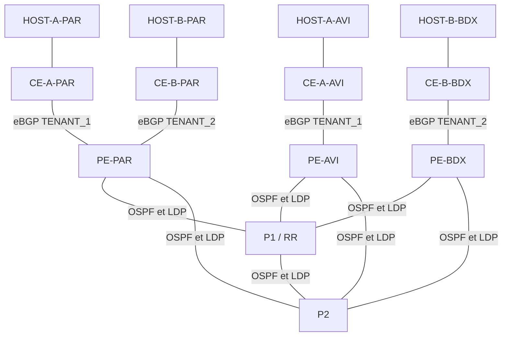

# Feuille de route de la journée projet

Ce document conserve la conception complète du PoC, y compris les phases
L3VPN futures. L'exécution du 6 novembre 2026 et les vérifications réellement
effectuées sont décrites dans [le journal du jour](journal-2026-11-06.md) et
[la procédure LAB](deploiement.md). Les passages « à prévoir » ci-dessous
décrivent la conception initiale et ne constituent pas des preuves d'exécution.

Références de travail : sujet « Plan_Module_Réseaux_Modernes_NetOps »,
diapositives 5 et 6, supports Introduction MPLS L3VPN et Introduction NetOps,
et architecture corrigée communiquée par l'utilisateur.
Les informations d'infrastructure proviennent aussi des sorties `ip a`
de toolsG2 et labG2 fournies par l'utilisateur. Leur analyse détaillée figure
dans [Environnement des deux VM](environnement-vm.md).

## 1. Analyse du besoin

### Comprendre les deux filiales

| Filiale | Sites | Intranet |
|---|---|---|
| A | Paris et Avignon | TENANT_1 |
| B | Paris et Bordeaux | TENANT_2 |

Chaque filiale doit relier ses deux agences. Les deux intranets doivent rester
étanches. L'opérateur prend en charge le réseau et son exploitation.

### Contraintes

- Déploiement de chaque intranet en moins de 20 minutes, à mesurer lors du PoC.
- Ajout d'un site et changement de LAN avec une intervention reproductible.
- Service MPLS L3VPN, OSPF aire 0 et LDP dans le réseau opérateur.
- MP-BGP VPNv4 en iBGP dans l'AS 65000, avec P1 comme Route Reflector.
- eBGP entre les PE et les CE.
- Deux VRF clientes, avec des conventions RD et RT explicites.
- Docker, Containerlab et cEOS pour le laboratoire fourni.
- Deux VM disponibles : toolsG2 en 10.108.2.29/24 et labG2 en 10.108.2.65/24.
- Adresses VM dynamiques et accès inter-VM/management à vérifier.
- Ansible et Jinja2 via eAPI HTTPS/443 pour le provisionnement futur.
- Checkup ponctuel et chaîne d'observabilité gNMI, gnmic, Prometheus et Grafana.
- Versionnement Git et démonstration orale.

### Équipements

| Type | Noms | Nombre |
|---|---|---:|
| Host | HOST-A-PAR, HOST-A-AVI, HOST-B-PAR, HOST-B-BDX | 4 |
| CE | CE-A-PAR, CE-A-AVI, CE-B-PAR, CE-B-BDX | 4 |
| PE | PE-PAR, PE-AVI, PE-BDX | 3 |
| P | P1, P2 | 2 |
| Total réseau | | 13 |

Le host représente un poste du site. Le CE est le routeur client. Le PE porte
les VRF clientes. Le P assure le transport MPLS. P1 cumule les rôles P et RR.

La mention « un PE par site » du sujet ne concorde pas avec son total de 13.
L'architecture corrigée de l'utilisateur fait référence : Paris partage un PE.
Les deux P répondent au schéma du PoC, leur nombre n'est pas un minimum
universel requis par MPLS.

### Critères de réussite

| Critère | Preuve à recueillir ultérieurement |
|---|---|
| Communication A Paris/Avignon | Tests dans les deux sens entre les hosts A |
| Communication B Paris/Bordeaux | Tests dans les deux sens entre les hosts B |
| Isolation A/B | Absence de routes étrangères dans les VRF et tests croisés négatifs |
| Transport disponible après perte d'un lien PE-P | Contrôle du chemin alternatif et mesure des pertes |
| Déploiement inférieur à 20 minutes par intranet | Chronométrage et journal d'exécution |
| Changements reproductibles | Diff Git, modification des variables et résultats de vérification |
| Exploitation observable | États des équipements et métriques visibles lors de la future démonstration |

Le périmètre du chronométrage reste à préciser avec l'enseignant : début,
fin et prise en compte du démarrage des conteneurs. Aucun temps n'est mesuré.

## 2. Conception réseau

### Topologie logique retenue

Chaque PE dispose d'un lien vers P1 et d'un lien vers P2. Les CE n'établissent
pas de sessions de routage directement entre eux. Les échanges intersites
traversent les PE et le cœur MPLS.

### Positionnement des VRF

| PE | VRF | CE raccordés |
|---|---|---|
| PE-PAR | TENANT_1 et TENANT_2 | CE-A-PAR et CE-B-PAR |
| PE-AVI | TENANT_1 | CE-A-AVI |
| PE-BDX | TENANT_2 | CE-B-BDX |

P1 réfléchit les routes VPNv4 entre les trois PE, qui sont ses clients iBGP.
Ces sessions logiques utilisent les loopbacks, accessibles grâce à OSPF.
P2 assure le transport sans rôle BGP prévu dans cette architecture.

P1 conserve les routes VPNv4 dans BGP du fait de son rôle RR. Les LAN clients
n'ont pas à apparaître dans la table IP globale des P. Le next-hop des routes
réfléchies doit rester celui du PE d'origine.

La double connexion protège contre la perte d'un lien de transport. P1 reste
l'unique RR, et chaque site garde un seul CE et un seul PE d'accès.
L'isolation des VRF ne chiffre pas les communications.

### Répartition proposée sur les VM

| VM | Adresse observée sur ens18 | Rôle proposé |
|---|---|---|
| toolsG2 | 10.108.2.29/24 | Git, documentation, Nautobot et futurs outils complémentaires |
| labG2 | 10.108.2.65/24 | Docker, Containerlab, neuf cEOS, quatre hosts Linux et premier contrôleur Ansible |

Ces rôles sont retenus pour la phase du 6 novembre ; le transfert ultérieur
du contrôleur Ansible vers TOOLS reste possible.
Les VM appartiennent au même sous-réseau IPv4 d'infrastructure. Leurs IP ne
remplacent ni les adresses LAN clientes ni les loopbacks ni les adresses de
management des équipements du PoC.

Le chemin de gestion proposé relie toolsG2 aux conteneurs de labG2 via
172.31.255.0/24. Un accès routé via 10.108.2.65 nécessitera de vérifier le
routage, le transfert sur labG2, le filtrage Docker et le chemin retour.
Aucune de ces fonctions n'est déduite comme opérationnelle des sorties `ip a`.

## 3. Plan d'adressage proposé

Les adresses des VM sont observées dans les sorties fournies. Toutes les
adresses des équipements et liens du PoC restent proposées et à valider.
Le détail des interfaces et des adresses figure dans `data/fabric.yml`.

### LAN des sites

| Site | LAN | Passerelle CE | Host | AS du CE |
|---|---|---|---|---:|
| A Paris | 10.10.10.0/24 | 10.10.10.1 | 10.10.10.10 | 65101 |
| A Avignon | 10.10.20.0/24 | 10.10.20.1 | 10.10.20.10 | 65102 |
| B Paris | 10.20.10.0/24 | 10.20.10.1 | 10.20.10.10 | 65201 |
| B Bordeaux | 10.20.20.0/24 | 10.20.20.1 | 10.20.20.10 | 65202 |

Un AS distinct par CE évite d'avoir à traiter dès le départ le rejet d'une
route contenant le même AS client. Les /24 facilitent la lecture du PoC.

### Loopbacks

| Équipement | Loopback /32 |
|---|---|
| P1 | 10.255.0.1 |
| P2 | 10.255.0.2 |
| PE-PAR | 10.255.0.11 |
| PE-AVI | 10.255.0.12 |
| PE-BDX | 10.255.0.13 |
| CE-A-PAR | 10.255.0.101 |
| CE-A-AVI | 10.255.0.102 |
| CE-B-PAR | 10.255.0.103 |
| CE-B-BDX | 10.255.0.104 |

Les loopbacks des CE servent d'identifiants proposés. Elles ne sont pas
destinées à être annoncées dans l'OSPF du réseau opérateur.

### Liens CE-PE

| Liaison | Adresse PE | Adresse CE |
|---|---|---|
| PE-PAR / CE-A-PAR | 172.16.0.1/30 | 172.16.0.2/30 |
| PE-AVI / CE-A-AVI | 172.16.0.5/30 | 172.16.0.6/30 |
| PE-PAR / CE-B-PAR | 172.16.0.9/30 | 172.16.0.10/30 |
| PE-BDX / CE-B-BDX | 172.16.0.13/30 | 172.16.0.14/30 |

### Liens PE-P et P-P

| Liaison | Première extrémité | Seconde extrémité |
|---|---|---|
| PE-PAR / P1 | 10.0.0.1/30 | 10.0.0.2/30 |
| PE-PAR / P2 | 10.0.0.5/30 | 10.0.0.6/30 |
| PE-AVI / P1 | 10.0.0.9/30 | 10.0.0.10/30 |
| PE-AVI / P2 | 10.0.0.13/30 | 10.0.0.14/30 |
| PE-BDX / P1 | 10.0.0.17/30 | 10.0.0.18/30 |
| PE-BDX / P2 | 10.0.0.21/30 | 10.0.0.22/30 |
| P1 / P2 | 10.0.0.25/30 | 10.0.0.26/30 |

Les /30 privilégient la lisibilité pédagogique. Le management des futurs
conteneurs utilise le réseau proposé 172.31.255.0/24 sur labG2, avec une
passerelle de bridge proposée 172.31.255.1.

Les deux VM présentent déjà 172.17.0.0/16 sur docker0 et 172.18.0.0/16 sur
un autre bridge. Le plan proposé ne chevauche ni ces réseaux, ni le réseau
d'infrastructure 10.108.2.0/24. Les routes et réseaux non montrés restent à
contrôler. Les bridges 172.18.0.0/16 des deux VM sont des réseaux locaux
distincts : leur adresse identique ne crée pas un réseau partagé entre VM.

Les IP 10.108.2.29 et 10.108.2.65 portent le marqueur `dynamic`.
Prévoir leur stabilité ou la mise à jour des variables si les baux changent.
La passerelle par défaut des VM n'est pas fournie et n'est pas supposée.

### Conventions RD et RT

RD proposé : `loopback-du-PE:identifiant-VRF`, avec 100 pour TENANT_1 et
200 pour TENANT_2. Chaque instance de VRF sur un PE dispose ainsi d'un RD distinct.

| VRF | PE | RD | RT import et export |
|---|---|---|---|
| TENANT_1 | PE-PAR | 10.255.0.11:100 | 65000:100 |
| TENANT_1 | PE-AVI | 10.255.0.12:100 | 65000:100 |
| TENANT_2 | PE-PAR | 10.255.0.11:200 | 65000:200 |
| TENANT_2 | PE-BDX | 10.255.0.13:200 | 65000:200 |

Le RD distingue les routes VPNv4. Le RT détermine leur import et leur export.
Aucun import croisé entre les deux filiales n'est prévu.

## 4. Préparation de l'environnement

| Point | État connu | Suite à prévoir |
|---|---|---|
| VM d'outillage | toolsG2 : ens18 UP, 10.108.2.29/24 dynamique | Confirmer les outils et les ressources disponibles |
| VM de laboratoire | labG2 : ens18 UP, 10.108.2.65/24 dynamique | Confirmer la joignabilité depuis toolsG2 |
| Docker | Interfaces docker0 et bridge présentes sur les deux VM | Vérifier moteur, version et droits d'accès sur chaque VM |
| Containerlab | Présence non démontrée par ip a | Vérifier sa présence et sa version sur labG2 |
| Images cEOS | Disponibilité et version non vérifiées | Identifier les images fournies sur labG2 |
| Ressources | CPU, mémoire disponible et disque non mesurés | Mesurer séparément toolsG2 et labG2 |
| Conteneurs existants | Deux interfaces veth sont visibles sur le bridge de labG2 | Identifier les conteneurs existants avant toute réalisation |
| Conteneurs réseau du PoC | 13 prévus sur labG2 | Confirmer 9 cEOS et 4 hosts Linux |
| Management distant | Accès toolsG2 vers 172.31.255.0/24 non vérifié | Préparer routage, filtrage et chemin retour |

Les services gnmic, Prometheus et Grafana peuvent ajouter trois conteneurs
si chacun est conteneurisé sur toolsG2. Ils ne font pas partie du total réseau
de 13 hébergé sur labG2. Le dimensionnement distingue les ressources des deux
VM et tient compte des services et conteneurs déjà présents.

Aucune installation, import d'image ou création de conteneur n'a été réalisé
sur les VM dans le cadre de cette préparation. L'état des interfaces provient
des sorties fournies, sans connexion distante effectuée par l'assistant.
Les vérifications antérieures sur Windows ne caractérisent pas ces deux VM.
Les contrôles en lecture seule restant à prévoir sont listés dans le
document d'environnement.

## 5. Préparation NetOps

- Dépôt Git : `Romain397/Reseau-NetOps`.
- `inventory/hosts.yml` : deux VM d'infrastructure, neuf routeurs EOS et quatre hosts.
- `inventory/group_vars/eos.yml` : paramètres de connexion eAPI HTTPS/443.
- `data/fabric.yml` : variables et adressage proposés, sans identifiants.
- `templates/eos.cfg.j2` : squelette Jinja2, à compléter lors d'une phase ultérieure.

Les noms de l'inventaire reprennent en minuscules ceux du schéma.
L'authentification, les certificats et les versions des outils restent à
préciser. Les variables de conception ne sont pas encore reliées à un
playbook de génération. Aucun template n'a été rendu ni envoyé à un routeur.
Le compte `NetOps`, observé dans les invites des VM, est renseigné uniquement
pour le groupe d'infrastructure. Le compte eAPI des routeurs reste à définir.
L'inventaire contient 15 entrées, dont 13 équipements réseau du PoC.

## 6. Documentation

### Choix techniques à expliquer

| Choix | Justification |
|---|---|
| PE-PAR partagé | Mutualiser l'accès opérateur tout en séparant les deux VRF |
| Deux RT distincts | Limiter les imports aux routes de la bonne filiale |
| OSPF aire 0 | Assurer la joignabilité des liens et loopbacks opérateur |
| LDP | Distribuer les labels de transport |
| MP-BGP VPNv4 | Échanger les préfixes VPN et leurs labels de service |
| RR sur P1 | Limiter le nombre de sessions iBGP entre les PE |
| eBGP PE-CE | Échanger les routes clientes à la frontière du service |
| Ansible, Jinja2 et Git | Décrire et versionner la préparation des changements |
| gNMI, gnmic, Prometheus et Grafana | Prévoir une observation continue du réseau |

### Scénarios de tests à exécuter ultérieurement

Tous les scénarios ci-dessous sont **non exécutés**.

| Test | Précondition et action future | Résultat attendu |
|---|---|---|
| E01 Accès VM | Contrôler la joignabilité entre 10.108.2.29 et 10.108.2.65 | Accès inter-VM conforme aux règles du laboratoire |
| E02 Accès de gestion | Depuis toolsG2, contrôler le chemin vers les IP de management et les services eAPI/gNMI des futurs cEOS | Accès individuels aux routeurs, chemin retour disponible |
| T01 Inventaire | Comparer les équipements du labo avec le schéma | 13 nœuds réseau conformes |
| T02 OSPF | Examiner les voisins et la joignabilité des loopbacks | Adjacences FULL, loopbacks opérateur joignables |
| T03 LDP | Examiner voisins, associations et chemins de labels | Transport MPLS vers les PE distants |
| T04 VPNv4 | Examiner les sessions entre P1 et les trois PE | Trois sessions RR clientes établies |
| T05 eBGP | Examiner les quatre sessions PE-CE | Sessions établies, LAN attendus annoncés |
| T06 Filiale A | Joindre les deux hosts A dans les deux sens | Communication réussie |
| T07 Filiale B | Joindre les deux hosts B dans les deux sens | Communication réussie |
| T08 Isolation | Après T06/T07, tester les huit couples orientés de hosts A/B et examiner les VRF | Échecs croisés et absence de routes étrangères |
| T09 Transport | Couper un seul lien PE-P puis le rétablir | Chemin alternatif, pertes et temps de retour mesurés |
| T10 Durée | Chronométrer le déploiement futur selon le périmètre convenu | Moins de 20 minutes par intranet |
| T11 Évolution | Préparer un ajout de site ou un changement de LAN dans les variables | Changement maîtrisé, tests de connectivité et d'isolation satisfaits |
| T12 Supervision | Observer une variation d'état et les métriques correspondantes | Chaîne d'observabilité vérifiable |

Un ping négatif seul ne prouve pas l'isolation. Il faut d'abord valider la
connectivité autorisée et contrôler les tables des VRF. Les tests utilisateurs
doivent cibler les adresses LAN, en évitant un détour par le réseau de management.

### Préparation de l'oral

1. Présenter le besoin des deux filiales et les contraintes du client.
2. Lire le schéma et expliquer les 13 équipements, dont le PE parisien partagé.
3. Distinguer OSPF, LDP, MP-BGP et eBGP dans le fonctionnement du service.
4. Expliquer la différence entre VRF, RD, RT et labels MPLS.
5. Présenter les brouillons d'inventaire, de variables et de templates.
6. Présenter les scénarios prévus et, lorsqu'ils existeront, les preuves recueillies.
7. Expliquer les limites : RR unique, accès client unique et absence de chiffrement MPLS.

À ce stade, l'oral porte sur la conception et la préparation. Les résultats
réseau et les captures de démonstration restent à produire lors de la réalisation.
