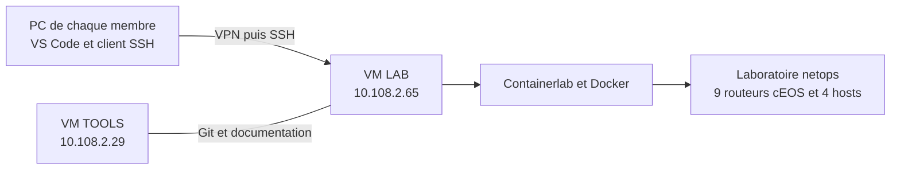

# Guide du groupe — se connecter au laboratoire Containerlab et l'utiliser

Ce guide permet à chaque membre du groupe de partir de son propre PC,
de rejoindre la VM LAB dans VS Code, de voir les équipements et d'effectuer
les premiers tests. La procédure principale concerne Windows 10/11.
Une adaptation macOS/Linux figure en fin de document.

**Résultat attendu :** une fenêtre VS Code portant la mention
**SSH: netops-lab**, le laboratoire **netops (NetOps)** dans **Running Labs**,
et ses **13 équipements actifs**.

Les mots de passe ne figurent pas dans ce guide. Les récupérer auprès du
responsable du groupe par le canal privé convenu.

## 1. Comprendre où fonctionne le laboratoire



Tous les membres accèdent au **même laboratoire**. Les changements effectués
sur un routeur ou dans le dossier partagé sont visibles par les autres.
Fermer sa fenêtre VS Code ne supprime pas les conteneurs.

Sur chaque PC, il faut le VPN du projet, VS Code et un client OpenSSH.
Docker Desktop, WSL, Ansible, les images cEOS et Containerlab lui-même ne
sont pas nécessaires sur le PC pour utiliser cette connexion distante.
Ils ne sont pas à réinstaller sur LAB pour rejoindre le labo existant.

## 2. Informations à utiliser par tout le groupe

| Élément | Valeur |
|---|---|
| VM à contacter pour le réseau | **LAB : 10.108.2.65** |
| Compte prévu dans ce guide | **NetOps** |
| Port SSH | **22** |
| Nom local de la connexion | **netops-lab** |
| Dossier du projet sur LAB | **/home/NetOps/Reseau-NetOps** |
| Laboratoire dans l'extension | **netops (NetOps)** |
| Fichier de topologie déployé | **topology.yml** |
| VM d'outillage | TOOLS : 10.108.2.29 |
| Dépôt GitHub | [Romain397/Reseau-NetOps](https://github.com/Romain397/Reseau-NetOps) |

Le compte NetOps est celui actuellement utilisé sur LAB. Si le responsable
vous attribue un compte personnel, lui demander aussi le dossier accessible,
les droits Docker/Containerlab et la visibilité du laboratoire appartenant
à NetOps ; remplacer le nom de connexion dans les commandes si nécessaire.
La création de comptes personnels n'est pas réalisée par ce guide.

Les adresses des VM sont attribuées par DHCP. Si le responsable annonce
un changement d'adresse de LAB, mettre à jour `HostName` dans votre configuration.

### Repérer l'endroit où saisir les commandes

| Environnement | Comment le reconnaître | Commandes typiques |
|---|---|---|
| **PC Windows** | PowerShell, invite commençant souvent par `PS C:\...>` | `Test-NetConnection`, `ssh`, configuration du client |
| **VM LAB** | Terminal Linux ; `hostname` répond `labG2` | `docker`, `containerlab`, `python3`, `git` |
| **Routeur EOS** | Invite `p1>`, `p1#`, `pe-par#`, etc. | `show ip interface brief`, `show ip ospf neighbor` |
| **Host Linux** | Shell ouvert à l'intérieur d'un conteneur host | `ip address`, `ip route`, `ping` |

Copier uniquement les commandes des blocs de code, sans ajouter le texte
de l'invite. Les identifiants et mots de passe de connexion à la VM ne
constituent pas des comptes d'administration des routeurs EOS.

## 3. Préparer son PC Windows

### 3.1 Installer VS Code

1. Télécharger [Visual Studio Code](https://code.visualstudio.com/download).
2. Installer la version correspondant au PC et ouvrir VS Code.
3. Ouvrir les extensions avec **Ctrl+Maj+X**.
4. Rechercher **Remote - SSH**, éditeur **Microsoft**.
5. Vérifier l'identifiant **ms-vscode-remote.remote-ssh**, puis installer.

L'extension Containerlab sera vérifiée dans la fenêtre distante après connexion.

### 3.2 Vérifier le client OpenSSH

Ouvrir **PowerShell sur le PC** et saisir :

```powershell
ssh -V
```

**Attendu :** une version OpenSSH s'affiche. Si `ssh` n'est pas reconnu ou
si cette commande n'affiche rien, essayer le chemin Windows explicite :

```powershell
& "$env:WINDIR\System32\OpenSSH\ssh.exe" -V
```

Si le client n'est pas installé, ouvrir les paramètres Windows, rechercher
**Fonctionnalités facultatives**, puis ajouter **Client OpenSSH**.
Il faut le **client**, pas le serveur OpenSSH.

Autre méthode, dans un **PowerShell lancé comme administrateur**, si
l'installation est permise sur le PC :

```powershell
Add-WindowsCapability -Online -Name OpenSSH.Client~~~~0.0.1.0
```

Fermer puis rouvrir PowerShell et refaire `ssh -V`. Sur un PC géré par
l'établissement, demander l'installation à la personne qui possède les droits.

## 4. Connecter le VPN et vérifier l'accès à LAB

Chaque membre utilise le profil et les identifiants VPN qui lui ont été
fournis. Ils ne sont pas inclus dans GitHub. Vérifier que le VPN indique
une connexion établie avant de continuer.

Dans **PowerShell sur le PC** :

```powershell
Test-NetConnection 10.108.2.65 -Port 22
```

**Attendu :** `TcpTestSucceeded : True`.

Si le résultat est `False`, contrôler le VPN et l'adresse de LAB avec le
responsable. Ne pas tenter de corriger cela en redéployant la topologie :
la connexion SSH à la VM doit fonctionner avant de rejoindre Containerlab.
Un ping refusé ne suffit pas à conclure à une panne si le port SSH répond.

## 5. Réussir une première connexion SSH

Dans **PowerShell sur le PC** :

```powershell
ssh NetOps@10.108.2.65
```

### Première connexion : identité du serveur

SSH peut demander de confirmer l'identité du serveur. L'empreinte publique
**ED25519** relevée sur la VM LAB est :

```text
SHA256:FSJcPRnkPtjaW+Q5y6WfGwtm2AFNqgyeyeTbdLq4/aM
```

Comparer l'empreinte affichée. Si elle correspond, répondre `yes`.
Si elle diffère, si le type de clé annoncé est différent ou si SSH annonce
un changement d'identité, demander confirmation au responsable avant de continuer.
Une réinstallation de la VM peut nécessiter une actualisation de cette référence.

### Authentification et vérification

1. Saisir le mot de passe communiqué en privé, si SSH le demande.
2. Aucun caractère ne s'affiche pendant la saisie : c'est normal.
3. Une fois connecté, saisir :

```sh
hostname
whoami
```

**Attendu :** `labG2`, puis `NetOps` pour le compte prévu dans ce guide.

Pour revenir sur le PC :

```sh
exit
```

**Point de contrôle :** ne passer à VS Code qu'après avoir réussi cette connexion.
Une clé configurée sur le PC d'un autre membre ne donne pas automatiquement
un accès au vôtre. Le mot de passe permet de démarrer ; une clé personnelle
peut être ajoutée ensuite, selon la section 14.

## 6. Créer l'alias netops-lab sur son propre PC

Dans **PowerShell sur le PC** :

```powershell
New-Item -ItemType Directory -Force "$env:USERPROFILE\.ssh" | Out-Null
notepad "$env:USERPROFILE\.ssh\config"
```

Accepter la création du fichier si nécessaire. Dans ce fichier, ajouter
le bloc suivant en conservant les autres connexions qui pourraient déjà exister :

```sshconfig
Host netops-lab
    HostName 10.108.2.65
    User NetOps
    Port 22
    ServerAliveInterval 30
```

Enregistrer le fichier sous le nom **config**, sans extension `.txt`.
Il se trouve dans le dossier `.ssh` du profil de chaque membre. Aucun chemin
vers le profil Windows d'une autre personne ne doit être copié.

Tester dans **PowerShell sur le PC** :

```powershell
ssh netops-lab
```

Refaire `hostname`, puis `exit`. Le résultat doit être le même qu'avec
l'adresse IP utilisée directement.

## 7. Ouvrir la VM LAB dans VS Code

1. Ouvrir VS Code sur le PC.
2. Faire **Ctrl+Maj+P** pour ouvrir la palette des commandes.
3. Rechercher **Remote-SSH: Connect to Host...** ou son équivalent traduit.
4. Choisir **netops-lab**.
5. Une nouvelle fenêtre distante s'ouvre. Choisir **Linux** si la plateforme est demandée.
6. Saisir le mot de passe de NetOps, ou la phrase secrète de sa propre clé, si nécessaire.
7. Attendre la fin de la connexion et de l'installation éventuelle de VS Code Server.
8. Vérifier la mention **SSH: netops-lab** en bas à gauche.
9. Faire **Fichier → Ouvrir le dossier...** et saisir :

```text
/home/NetOps/Reseau-NetOps
```

Confirmer l'ouverture. Si VS Code demande si le dossier est fiable,
vérifier qu'il s'agit bien du dossier du groupe avant de lui accorder sa confiance.
Le premier démarrage peut prendre plusieurs minutes ; laisser une seule
connexion terminer son installation avant d'en ouvrir d'autres.

Ouvrir ensuite **Terminal → Nouveau terminal** dans cette fenêtre et saisir :

```sh
hostname
pwd
```

**Attendu :** `labG2` et `/home/NetOps/Reseau-NetOps`.
Si le terminal affiche un chemin Windows, vérifier que vous utilisez bien
la fenêtre portant **SSH: netops-lab**.

Le dossier existe déjà sur LAB. Pour consulter le labo, chaque membre
n'a pas besoin de cloner une seconde copie ou de lancer le déploiement.

## 8. Installer ou activer Containerlab au bon endroit

Dans la **fenêtre distante SSH: netops-lab** :

1. Ouvrir les extensions avec **Ctrl+Maj+X**.
2. Rechercher **Containerlab**, éditeur **SRL Labs**.
3. Vérifier l'identifiant **srl-labs.vscode-containerlab**.
4. Si le bouton **Install in SSH: netops-lab** apparaît, l'utiliser.
5. Si l'extension est déjà installée dans la catégorie de l'hôte SSH, la conserver activée.
6. Installer les dépendances YAML/Draw.io si elles sont proposées avec l'extension.
7. Si un rechargement est demandé, recharger la fenêtre distante.

Avec le compte partagé NetOps, les extensions distantes sont celles du
même profil Linux. Une installation sur LAB peut donc déjà être disponible
pour les autres membres ; le client Remote SSH reste à installer sur chaque PC.

**Point de contrôle :** l'icône Containerlab doit apparaître dans la barre
latérale de la fenêtre distante. Une installation uniquement dans la
catégorie **Local** ne suffit pas à gérer les conteneurs de LAB.

### Paramètres de référence sur LAB

La configuration distante de référence utilise :

```json
{
  "containerlab.binaryPath": "/usr/bin/containerlab",
  "containerlab.node.execCommandMapping": {
    "arista_ceos": "Cli",
    "linux": "sh"
  }
}
```

Ces valeurs sont déjà configurées pour le compte NetOps sur LAB. Pour les
vérifier, utiliser la palette **Preferences: Open Remote Settings (JSON)**
depuis la fenêtre SSH. Conserver les autres réglages du fichier.
Ne pas placer le chemin Linux du binaire dans les paramètres locaux Windows.
Coordonner toute modification des paramètres distants : ils sont partagés
si tout le groupe utilise NetOps.

## 9. Retrouver les équipements et le schéma

1. Cliquer sur l'icône **Containerlab**.
2. Ouvrir la section **Running Labs**.
3. Développer **netops (NetOps)**.
4. Vérifier les treize équipements :

| Type | Noms | Nombre |
|---|---|---:|
| P | p1, p2 | 2 |
| PE | pe-par, pe-avi, pe-bdx | 3 |
| CE | ce-a-par, ce-a-avi, ce-b-par, ce-b-bdx | 4 |
| Hosts | host-a-par, host-a-avi, host-b-par, host-b-bdx | 4 |

Les équipements doivent apparaître en état **running**. La couleur de
l'indicateur peut dépendre du thème ; vérifier aussi l'état écrit.
Pour consulter le schéma dans la version de référence :

1. **Double-cliquer sur le nom `netops (NetOps)`** dans Running Labs.
2. Attendre l'ouverture de l'onglet **netops** au centre de VS Code.
3. Vérifier que les treize équipements et leurs quinze liens sont dessinés.

Ce raccourci a été testé sur le laboratoire. L'action de la vue interactive
est nommée **Open TopoViewer** dans cette version.

Le menu **Graph** contient aussi des fonctions de dessin **draw.io**.
L'option **Interactive** de draw.io ouvre un assistant dans un terminal avec
les textes **Assign Levels** et **Confirm Level**. Cet assistant attend une
sélection ; il explique pourquoi aucun dessin ne s'affiche immédiatement.
Pour ouvrir directement la vue TopoViewer, revenir à Running Labs et
utiliser le double-clic décrit ci-dessus.

Le laboratoire est déjà actif. Le fichier déployé est **topology.yml**.
L'extension le retrouve à partir des conteneurs en fonctionnement.
Les fichiers `.clab.yml` ou `.clab.yaml` sont utilisés pour la découverte
des topologies non déployées et pour certains boutons de l'éditeur.
Si un fichier généré apparaît dans **Undeployed Local Labs**, utiliser
l'entrée de **Running Labs** pour administrer le labo déjà démarré.

**Ne pas utiliser Deploy, Redeploy ou Destroy pour simplement se connecter.**
Ces actions concernent le laboratoire partagé et peuvent affecter tout le groupe.

## 10. Faire fonctionner un premier routeur et un premier host

### 10.1 Ouvrir P1

Dans l'explorateur Containerlab, clic droit ou menu de **p1**, puis **Attach**.
Le réglage de référence ouvre directement le CLI EOS.

Autre méthode, dans le **terminal Linux de LAB** :

```sh
docker exec -it clab-netops-p1 Cli
```

Dans le **CLI EOS de P1**, saisir une commande à la fois :

```text
show ip interface brief
show ip ospf neighbor
show ip route ospf
ping 10.255.0.11 source Loopback0 repeat 3
```

**Attendu :** les interfaces et Loopback0 sont adressées, P1 possède
**quatre voisins FULL**, et le ping vers la loopback de PE-PAR réussit.
Ces commandes consultent l'état du routeur.

Pour quitter le CLI et revenir au terminal de LAB :

```text
exit
```

Si Attach ouvre un shell Linux dans un cEOS, saisir `Cli` pour rejoindre
EOS, puis faire vérifier le réglage d'attachement du profil distant.

### 10.2 Tester un poste client

Dans le **terminal Linux de LAB** :

```sh
docker exec clab-netops-host-a-par ping -I eth1 -c 3 10.10.10.1
```

**Attendu :** trois réponses du CE du site A Paris, sans perte.
L'option `-I eth1` impose l'interface du LAN client.

Pour ouvrir le shell du host :

```sh
docker exec -it clab-netops-host-a-par sh
```

Dans ce **host Linux** :

```sh
ip -br address
ip route
exit
```

`exit` revient au terminal de LAB. Un second `exit` peut fermer la session
SSH si vous étiez connecté directement depuis PowerShell.

## 11. Vérifier le laboratoire complet

Dans le **terminal Linux de LAB**, depuis le dossier du projet :

```sh
cd /home/NetOps/Reseau-NetOps
containerlab inspect -t topology.yml
python3 scripts/verify.py --ospf
```

**Résultats attendus pour le socle actuel :**

- 13 conteneurs actifs et 15 liens de données.
- 30 pings de voisinage réussis sur ces liens, dans les deux sens.
- Voisins OSPF FULL : P1 = 4, P2 = 4, chaque PE = 2.
- 20 pings entre loopbacks du backbone réussis.
- Bilan final : **91/91 contrôles réussis**.

Laisser une campagne se terminer avant d'en lancer une autre. Les résultats
sont écrits dans `reports/` sur LAB. Si un test échoue, relever la commande,
le nom de l'équipement et l'erreur, puis consulter la section dépannage.

Les hosts de sites différents ne communiquent pas encore : les VRF clientes,
LDP et MP-BGP/eBGP restent les prochaines étapes. Ce résultat est cohérent
avec le périmètre actuel. `running` confirme l'état du conteneur ; les tests
vérifient en plus le réseau IP et OSPF.

## 12. Travailler ensemble et conserver les changements

### Lecture et modification du labo partagé

Plusieurs membres peuvent se connecter et consulter le réseau. Pour les
changements de configuration, désigner la personne et l'équipement concernés
avant de commencer. Les fichiers sous `/home/NetOps/Reseau-NetOps`, les
routeurs et le profil Linux NetOps sont communs.

Les branches Git d'un même dossier sont aussi partagées : changer de branche
dans ce dossier change les fichiers vus par les autres. Pour une première
séance, faire les consultations ensemble et confier l'intégration Git à
une personne. Un travail indépendant nécessitera des copies de travail
séparées convenues avec le responsable.

### Sauvegarde après une modification autorisée

Dans le **CLI EOS** du routeur modifié :

```text
enable
write memory
```

Depuis le **terminal Linux de LAB**, il est aussi possible de sauvegarder
l'ensemble des routeurs, puis d'exporter les configurations :

```sh
cd /home/NetOps/Reseau-NetOps
containerlab save -t topology.yml
python3 scripts/snapshot.py
git diff -- configs/snapshots
git status
```

La sauvegarde dans EOS et le commit Git sont deux opérations différentes.
Le script d'export refuse les configurations contenant des éléments
potentiellement sensibles. L'intégrateur examine les différences, puis
crée le commit et effectue le push avec ses droits GitHub.

Pour mettre à jour une copie propre du dépôt, après coordination :

```sh
git pull --ff-only
```

Si Git signale des modifications locales ou une divergence, examiner
`git status` avec l'intégrateur. Ne pas supprimer le travail d'un autre
membre pour forcer une mise à jour.

`data/fabric.yml` décrit les paramètres, `configs/base/` les configurations
de démarrage et `configs/snapshots/` les configurations relevées.
`python3 scripts/prepare.py` régénère les fichiers, sans appliquer les
changements aux routeurs déjà actifs.

### Fin de séance

1. Terminer les modifications prévues et sauvegarder si nécessaire.
2. Quitter les CLI avec `exit`.
3. Fermer sa fenêtre VS Code distante ou utiliser **Close Remote Connection**.
4. Déconnecter son VPN après avoir quitté la connexion distante.

Le laboratoire reste sur LAB. Ne pas arrêter les conteneurs uniquement
parce qu'un membre termine sa séance.

## 13. Dépannage : partir du symptôme

| Symptôme | Contrôle à faire | Action adaptée |
|---|---|---|
| `ssh` n'est pas reconnu ou n'affiche rien | Essayer le chemin `C:\Windows\System32\OpenSSH\ssh.exe` | Vérifier ou installer le client OpenSSH |
| `TcpTestSucceeded : False` ou SSH expire | VPN connecté, bonne adresse de LAB, VM disponible | Faire confirmer la connectivité au responsable |
| `Connection refused` | La VM répond mais le service SSH n'accepte pas la connexion | Faire vérifier le service SSH et le port sur LAB |
| `Permission denied (publickey,password)` | Compte NetOps, mot de passe correct ou clé publique autorisée | Reprendre le test SSH simple ; une clé d'un autre PC ne fonctionne pas automatiquement |
| Le mot de passe semble ne pas se saisir | Aucun caractère ne s'affiche dans SSH | Saisir normalement puis appuyer sur Entrée |
| `Could not resolve hostname netops-lab` | Fichier `.ssh/config` présent, nom exact, pas de `.txt` | Corriger l'alias ou tester directement l'adresse IP |
| Avertissement de clé hôte modifiée | Empreinte et identité de LAB | Demander une vérification au responsable avant de modifier les clés connues |
| VS Code reste en connexion | Le SSH simple fonctionne-t-il ? Le serveur termine-t-il son installation ? | Attendre l'installation ; consulter **Affichage → Sortie → Remote - SSH** |
| Mauvais client SSH choisi par VS Code sous Windows | Paramètre local **Remote.SSH: Path** | Si OpenSSH Windows est installé à cet emplacement, indiquer `C:\Windows\System32\OpenSSH\ssh.exe` |
| Première installation distante trop lente | Progression dans les logs Remote - SSH | Augmenter au besoin le paramètre local `remote.SSH.connectTimeout` à `60`, puis retenter une seule connexion |
| Pas d'icône Containerlab dans la fenêtre distante | Section des extensions **SSH: netops-lab** | Installer/activer Containerlab côté LAB, puis recharger la fenêtre si demandé |
| L'extension propose d'installer Containerlab sur le PC | La barre d'état affiche-t-elle SSH: netops-lab ? | Ouvrir la bonne fenêtre distante ; vérifier ensuite le binaire sur LAB |
| `containerlab: command not found` | `hostname`, puis `command -v containerlab` dans le terminal utilisé | Confirmer que le terminal appartient à LAB ; le chemin attendu est `/usr/bin/containerlab` |
| Running Labs est vide | Bonne VM, extension distante active et conteneurs présents ? | Sur LAB, lancer `containerlab inspect --all` et `docker ps` ; ne pas lancer un second labo |
| Compte personnel : labo NetOps masqué | Filtre des laboratoires appartenant à d'autres utilisateurs | Vérifier le bouton **Hide Non-Owned Labs** et les droits avec le responsable |
| État de l'interface qui ne s'actualise pas | CLI `containerlab inspect --all` correcte mais vue figée | Dans les paramètres distants, essayer `containerlab.refreshMode` = `polling` |
| Docker répond `permission denied` | `id -nG` sur LAB | Faire vérifier le groupe docker et ouvrir une nouvelle connexion après une correction des droits |
| Fichier topology.yml sans boutons Containerlab | Le suffixe du fichier n'est pas `.clab.yml` | Utiliser le laboratoire actif dans Running Labs |
| Attach ouvre bash/sh au lieu d'EOS | Mapping d'attachement pour arista_ceos | Saisir `Cli` et faire vérifier les paramètres distants de la section 8 |
| Pings intersites en échec | Les tests de base et OSPF réussissent-ils ? | Le service L3VPN reste à configurer ; ne pas confondre ces pings avec le test host-vers-CE |
| Un test du script échoue | Sortie et journaux `reports/`, nœud concerné | Faire analyser le défaut avant de redéployer ou de modifier le routage |

Les versions validées sur l'installation de référence sont Containerlab
**0.82.0** sur LAB, Containerlab VS Code **0.26.3** et Remote SSH **0.128.0**
sur le poste préparé. Une mise à jour des outils du serveur partagé se
coordonne avec le groupe ; elle n'est pas une étape nécessaire pour rejoindre le labo.

## 14. Option : utiliser sa propre clé SSH

La connexion par mot de passe suffit pour les premières étapes si elle
est autorisée sur LAB. Une clé permet ensuite une connexion personnelle
au serveur. Chaque membre génère sa propre paire de clés sur son PC.

### 14.1 Générer une clé sur son PC Windows

Dans **PowerShell sur le PC** :

```powershell
ssh-keygen -t ed25519 -C "groupe-netops-lab" -f "$env:USERPROFILE\.ssh\id_ed25519_netops_lab"
```

Choisir une phrase secrète et la conserver pour les demandes du client SSH.
Si le fichier existe déjà, ne pas l'écraser : vérifier avec le responsable
si cette clé peut être réutilisée ou choisir un autre nom de fichier.

Deux fichiers sont créés :

| Fichier | Traitement |
|---|---|
| `id_ed25519_netops_lab` | Clé privée : reste sur le PC de son propriétaire |
| `id_ed25519_netops_lab.pub` | Clé publique : à faire autoriser sur LAB |

Afficher seulement la clé publique :

```powershell
Get-Content "$env:USERPROFILE\.ssh\id_ed25519_netops_lab.pub"
```

Transmettre au responsable la ligne commençant par `ssh-ed25519`.
Ne pas envoyer le fichier privé d'un membre aux autres membres.

### 14.2 Faire autoriser la clé publique sur LAB

Le responsable disposant d'un accès à LAB ajoute la ligne publique dans
`/home/NetOps/.ssh/authorized_keys`, en conservant les clés déjà présentes.
Les permissions attendues sont `700` pour `.ssh` et `600` pour
`authorized_keys`. Si des comptes personnels sont utilisés, il ajoute la clé
dans le compte réellement attribué au membre, au lieu de celui de NetOps.

Cette étape est à effectuer pour chaque nouvelle clé. Le guide ne crée
pas automatiquement des autorisations pour les autres PC.

Pour le responsable connecté à **LAB comme NetOps**, si les fichiers doivent
être préparés :

```sh
mkdir -p ~/.ssh
chmod 700 ~/.ssh
touch ~/.ssh/authorized_keys
chmod 600 ~/.ssh/authorized_keys
```

Dans la fenêtre VS Code distante, faire **Ctrl+P**, ouvrir
`/home/NetOps/.ssh/authorized_keys`, ajouter la clé publique sur une nouvelle
ligne, puis enregistrer avec **Ctrl+S**. Conserver toutes les lignes existantes.
Le membre peut alors tester sa clé depuis son propre PC.

### 14.3 Ajouter la clé à son alias local

Dans le fichier **config du PC**, compléter le bloc existant :

```sshconfig
Host netops-lab
    HostName 10.108.2.65
    User NetOps
    Port 22
    IdentityFile ~/.ssh/id_ed25519_netops_lab
    IdentitiesOnly yes
    ServerAliveInterval 30
```

Si un autre nom de clé a été choisi, adapter `IdentityFile`.
Tester à nouveau `ssh netops-lab`. La phrase secrète demandée appartient
à la clé privée du membre ; le mot de passe demandé pour NetOps appartient
au compte de la VM. La première ne doit pas être confondue avec le second.

## 15. Adaptation pour macOS et Linux

Le fonctionnement distant dans VS Code est identique : même VPN,
même alias SSH, même dossier sur LAB et mêmes extensions.

Dans le **terminal local du Mac ou du PC Linux** :

```sh
ssh -V
ssh -o ConnectTimeout=8 NetOps@10.108.2.65
```

Utiliser le client VPN fourni pour le système. Si SSH n'est pas disponible,
installer le client OpenSSH selon les consignes de l'établissement.
`Test-NetConnection` et `Add-WindowsCapability` sont des commandes Windows
et ne sont pas utilisées sur macOS/Linux.

Créer `~/.ssh/config` dans son propre profil et y mettre le bloc de la
section 6. Si une clé personnelle est choisie, l'exemple correspondant est :

```sh
mkdir -p ~/.ssh
chmod 700 ~/.ssh
ssh-keygen -t ed25519 -C "groupe-netops-lab" -f ~/.ssh/id_ed25519_netops_lab
cat ~/.ssh/id_ed25519_netops_lab.pub
```

Faire autoriser la clé publique selon la section 14. Les menus VS Code
restent les mêmes ; le raccourci de la palette est **Cmd+Maj+P** sur Mac
et **Ctrl+Maj+P** sur Linux. La méthode Remote SSH a été validée depuis le
poste Windows de référence ; les adaptations macOS/Linux n'ont pas été
testées sur les PC des autres membres.

## 16. Fiche de validation individuelle

Chaque membre peut cocher cette liste sur sa propre copie :

- [ ] Mon VPN est connecté.
- [ ] Le port SSH de LAB est joignable depuis mon PC.
- [ ] Je réussis `ssh NetOps@10.108.2.65` avec mon moyen d'authentification.
- [ ] Mon alias `ssh netops-lab` fonctionne.
- [ ] Ma fenêtre VS Code affiche **SSH: netops-lab**.
- [ ] Le terminal de cette fenêtre répond **labG2** à `hostname`.
- [ ] Le dossier ouvert est **/home/NetOps/Reseau-NetOps**.
- [ ] Containerlab est activé dans la catégorie de l'hôte SSH.
- [ ] Je vois **netops (NetOps)** et les 13 nœuds actifs.
- [ ] Je sais ouvrir le CLI EOS de P1 avec Attach ou `docker exec`.
- [ ] Je retrouve les quatre voisins FULL de P1.
- [ ] Le test host A Paris vers son CE réussit.
- [ ] Je sais lancer et retrouver le résultat de la campagne de tests.
- [ ] Je sais quitter ma session sans arrêter le laboratoire du groupe.

La connexion depuis chaque nouveau PC reste à valider par son propriétaire.
Le serveur et le poste de référence ont été vérifiés ; l'existence de ce
guide ne signifie pas que tous les postes du groupe sont déjà configurés.

## 17. Documents utiles

- [Documentation complète du projet](documentation-projet.md) : architecture, adressage et réalisations.
- [Câblage des quinze liens](cablage.md) : interfaces et IP des équipements.
- [Procédure de déploiement](deploiement.md) : à utiliser par la personne chargée de créer ou reconstruire le labo.
- [Environnement des VM](environnement-vm.md) : ressources et logiciels.
- [Dernier bilan réseau versionné](tests/ospf-after-vscode-summary.json) : campagne complète réussie du socle.

Références officielles : [VS Code Remote SSH](https://code.visualstudio.com/docs/remote/ssh),
[extension Containerlab](https://containerlab.dev/manual/gui/vsc-extension/),
[client OpenSSH Windows](https://learn.microsoft.com/en-us/windows-server/administration/openssh/openssh_install_firstuse)
et [clés SSH Windows](https://learn.microsoft.com/en-us/windows-server/administration/openssh/openssh_keymanagement).
